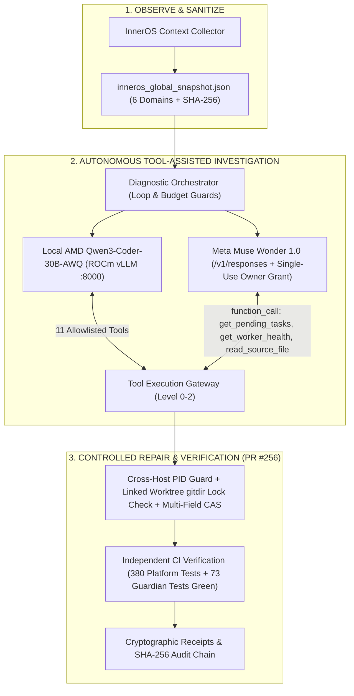

# InnerOS Autonomous Infrastructure Guardian
**The Infrastructure That Investigates and Heals Itself**  
*Meta Global AI Developer Hackathon 2026 — Startup Track (Push the Frontier / Build for Your World)*  
InnerChispa LLC · Guayaquil, Ecuador · Rafael López, Founder & CEO

[](https://github.com/Rafa-Innerchispa/inneros-meta-guardian-2026/actions/workflows/tests.yml)
[](https://www.python.org/)
[](LICENSE)

---

## Overview

> **EVIDENCE STATUS — 2026-11-03:** This repository provides two interactive Mission Control experiences: `/` (**Physical Guardian**) and `/self-heal` (**5-Panel Autonomous Coordination Investigator & Self-Healing Lab**), backed by **73/73 passing offline unit & HTTP integration tests** in Python 3.10 and 3.12 (`scripts/build_public_release.py --check` green with 0 credential/IP leaks). Core platform candidate **PR #256** (`2481d2e7`) passed **380/380** runtime safety and coordination tests in GitHub Actions CI (Run `41721839589`). Both **Local AMD Qwen3-Coder-30B-AWQ** (`6,440.31 ms`, `1,522` tokens, `$0.00` cost) and **Meta Muse Wonder 1.0** (`resp_6aea97477ecbaecc16a14e99` $\rightarrow$ 4 tool calls $\rightarrow$ `resp_6aea97f2ad831065ca8b4bc8`, `25,816.73 ms`, `3,843` tokens including `822` reasoning CoT tokens) have completed verified **2-turn tool-assisted investigations** against the sanitized `inneros_global_snapshot.json`. The public web UI never triggers unapproved paid API calls.

Most AI agents today answer questions inside chat windows. **InnerOS Autonomous Infrastructure Guardian** brings local-first and frontier AI into physical facilities, server racks, and multi-agent control planes:

```text
OBSERVE (Context Collector) ➔ INVESTIGATE (Tool Loop: Local Qwen 30B / Meta Muse Wonder 1.0) ➔ GOVERN (Policy & Single-Use Grant) ➔ PATCH (Isolated Worktree) ➔ VERIFY (Independent CI & Readback) ➔ PROVE (SHA-256 Audit Chain)
```

---

## Measured Comparison: Local AMD Qwen 30B vs. Meta Muse Wonder 1.0

| Metric | Local AMD Qwen3-Coder-30B-AWQ | Meta Muse Wonder 1.0 |
|---|---|---|
| **Compute / Endpoint** | AMD Radeon AI PRO R9700 (32 GB VRAM, ROCm 10.1, vLLM `:8000`) | Meta Model API (`POST https://api.meta.ai/v1/responses`, `muse-wonder-1.0`) |
| **2-Turn Tool-Assisted Latency** | **`6,440.31 ms`** (Turn 1: `3,168.74 ms` / Turn 2: `3,271.57 ms`) | **`25,816.73 ms`** (Turn 1: `6,035.72 ms` / Turn 2: `19,781.00 ms`) |
| **Single-Shot Baseline Latency** | `15,155.00 ms` (`1,367` tokens) | `22,059.67 ms` (`3,442` tokens, `1,420` reasoning CoT, `resp_6ae9322a12052fe018674cb6`) |
| **2-Turn Tool-Assisted Tokens** | **`1,522` tokens** (`1,153` prompt + `369` completion) | **`3,843` tokens** (`1,950` input + `1,893` output, incl. **`822` reasoning CoT**) |
| **Tools Requested by Model** | `get_pending_tasks`, `get_worker_health` | `get_pending_tasks` (`ops_4e977fd8ec43`), `get_pending_tasks` (`ops_fcd8686d7fc6`), `get_worker_health`, `read_source_file` (`ops_interactive_recovery.py`) |
| **Root Causes Identified** | Manual-only IDE lane (`do_not_auto_dispatch`), 15-day expired lease, cross-host PID hazard, linked worktree `.git` pointer lock | Strict separation of observed facts vs. hypotheses; verified all 4 root causes and specified 4 negative + 3 positive verification tests |
| **Verification Test Results** | `43/43` targeted PR #256 tests + `73/73` Guardian tests passing | `380/380` CI tests passing in GitHub Actions Run `41721839589` |
| **Operational Cost** | **`$0.00 USD`** (sovereign on-premises GPU) | Governed (`<= $0.50 USD` cap per single-use Owner Grant, `0` automatic retries) |
| **Evidence Artifact** | [`docs/evidence/qwen_tool_assisted_investigation_20261103.json`](docs/evidence/qwen_tool_assisted_investigation_20261103.json) | [`docs/evidence/meta_wonder_tool_investigation_20261103.json`](docs/evidence/meta_wonder_tool_investigation_20261103.json) |

---

## Key Features

1. **InnerOS Global Context Collector (`src/inneros_meta_guardian/context_collector.py`):**
   - Builds a versioned, sanitized 6-domain operational snapshot (`inneros_global_snapshot.json`, SHA-256 `92796a036c6fd89643a0be11898723d60b679565a86edcd88cb11583db5d5f83`) covering Infrastructure, NCP Coordination, Agents, Code, History, and Security.
   - Recursive sanitizer redacts private LAN/mesh IPs, API keys, tokens, and workstation/host paths before any external dispatch.
2. **Autonomous Multi-Turn Diagnostic Orchestrator (`src/inneros_meta_guardian/diagnostic_orchestrator.py`):**
   - Exposes 11 allowlisted diagnostic and verification tools across Level 0 (Read-Only), Level 1 (Simulation), and Level 2 (Isolated Worktree Verification): `get_ncp_state`, `get_pending_tasks`, `get_worker_health`, `get_agent_task_history`, `get_mcp_gateway_health`, `get_recent_errors`, `get_repo_status`, `read_source_file`, `read_log_excerpt`, `simulate_recovery_patch`, and `verify_repair_invariants`.
   - Enforces loop detection (`HALTED_LOOP_DETECTED`), call ceilings (`max_tool_calls=6`), token ceilings (`4096`), cost ceilings (`$0.50`), and operator cancellation.
3. **5-Panel Investigation Console (`/self-heal#investigator`):**
   - **Panel 1 (Conversation):** Multi-turn prompt, tool call requests, and final synthesized diagnosis.
   - **Panel 2 (Tool Execution Gateway):** Tool name, sanitized arguments, execution latency, result preview, and SHA-256 evidence digest.
   - **Panel 3 (Infrastructure):** Live snapshot summary of AMD Primary (`Radeon AI PRO R9700`, vLLM `:8000`), Intel Secondary (`:11434` offline), MCP `:8001`/`:8102`, and NCP task queues.
   - **Panel 4 (Decisions & Controlled Repair Levels 0–3):** Verified hypotheses `H1`–`H3` and explicit authorization boundaries.
   - **Panel 5 (Comparative Metrics):** Real measured benchmark table comparing Local AMD Qwen 30B vs. Meta Muse Wonder 1.0.
4. **Governed Meta Muse Wonder 1.0 & Muse Spark 1.3 Integration:**
   - Official Meta Model API Responses integration (`POST https://api.meta.ai/v1/responses`) with `function_call` tool extraction (`TOOL_CALL_REQUESTED`), accurate per-model SQLite receipt attribution, and atomic single-use cryptographic Owner Grants.
5. **Physical Infrastructure Guardian (`/`) & Meta SAM 3.1 Optical Lab Inspection:**
   - Read-only telemetry normalization, AG-60 memory recall with regex privacy redaction, SAM 3.1 optical rack inspection fixture, VoiceOps SIP/RTP telephone verification receipt, and tamper-evident SHA-256 hash chain.

---

## Architecture



---

## Quickstart & Local Execution

### Requirements
- Python 3.10+ (Standard library only; zero external pip dependencies required for the demo and test suite).
- Git.

### 1. Run the Complete Test Suite (73 Tests, 100% Offline) & Sanitizer Gate
```bash
# Windows PowerShell
$env:PYTHONPATH="src"; python -m unittest discover -s tests -v
python scripts/build_public_release.py --check

# Linux / macOS
PYTHONPATH=src python3 -m unittest discover -s tests -v
python3 scripts/build_public_release.py --check
```

### 2. Launch the Web Console
```bash
# Windows PowerShell
$env:PYTHONPATH="src"; python -m inneros_meta_guardian.web

# Linux / macOS
PYTHONPATH=src python3 -m inneros_meta_guardian.web
```
- Open **`http://127.0.0.1:8787/self-heal`** for the **5-Panel Muse & Qwen Autonomous Investigation Console** and the interactive self-healing sandbox replay.
- Open **`http://127.0.0.1:8787/`** for the **Physical Infrastructure Guardian** console.

---

## Evidence & Documentation Index

- [`docs/evidence/meta_wonder_tool_investigation_20261103.json`](docs/evidence/meta_wonder_tool_investigation_20261103.json): Verified 2-turn tool-assisted live investigation receipt from **Meta Muse Wonder 1.0** (`resp_6aea97477ecbaecc16a14e99` $\rightarrow$ 4 tool calls $\rightarrow$ `resp_6aea97f2ad831065ca8b4bc8`).
- [`docs/evidence/qwen_tool_assisted_investigation_20261103.json`](docs/evidence/qwen_tool_assisted_investigation_20261103.json): Verified 2-turn tool-assisted live investigation receipt from **Local AMD Qwen3-Coder-30B-AWQ** (`6,440.31 ms`, `1,522` tokens, `$0.00`).
- [`docs/evidence/inneros_global_snapshot_20261103.json`](docs/evidence/inneros_global_snapshot_20261103.json): Sanitized 6-domain InnerOS global snapshot (`SHA-256: 92796a036c6fd89643a0be11898723d60b679565a86edcd88cb11583db5d5f83`).
- [`docs/evidence/meta_wonder_receipt_20261102.json`](docs/evidence/meta_wonder_receipt_20261102.json): Single-shot Meta Muse Wonder 1.0 receipt (`resp_6ae9322a12052fe018674cb6`, `3,442` tokens, `1,420` reasoning CoT).
- [`docs/SUBMISSION_PACKAGE_20261104.md`](docs/SUBMISSION_PACKAGE_20261104.md): Complete Cerebral Valley submission form answers and 3-minute video script.
- [`docs/meta_muse_coordination_p0/status.json`](docs/meta_muse_coordination_p0/status.json): Canonical P0 coordination status manifest.

---

## License & Attribution

Released under the [MIT License](LICENSE). Copyright © 2026 InnerChispa LLC (Rafael López).  
Built for the **Meta Global AI Developer Hackathon 2026** (Meta × Cerebral Valley).
