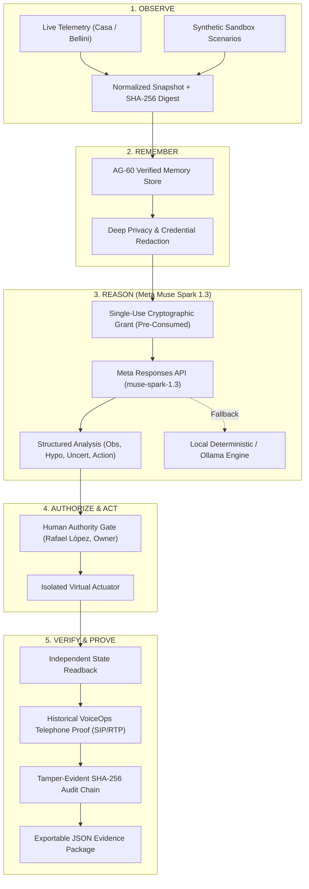

# InnerOS Autonomous Infrastructure Guardian
**The Infrastructure That Remembers and Responds**  
*Meta Global AI Developer Hackathon 2026 — Startup Track (Push the Frontier / Build for Your World)*  
InnerChispa LLC · Guayaquil, Ecuador · Rafael López, Founder & CEO

[](https://github.com/Rafa-Innerchispa/inneros-meta-guardian-2026/actions/workflows/tests.yml)
[](https://www.python.org/)
[](#license)

---

## Overview

Most AI agents today answer questions inside chat windows. **InnerOS Autonomous Infrastructure Guardian** brings frontier AI into the physical facilities, server racks, and network backbones that sustain modern operations.

Connected to live physical telemetry from Casa and Bellini facilities in Ecuador, InnerOS operates an end-to-end governed autonomic loop:
```
OBSERVE ➔ REMEMBER ➔ REASON ➔ AUTHORIZE ➔ ACT ➔ VERIFY ➔ PROVE
```

Powered by **Meta Muse Spark 1.3** and **Meta SAM 3.1**, InnerOS analyzes live signals alongside verified AG-60 historical memory to diagnose network anomalies, explicitly separating factual observations from hypotheses and uncertainty. Every remote inference is strictly bounded by an atomic single-use cryptographic operator grant. Physical actions remain gated by human authority (Rafael López, Owner), followed by independent state readback, verified VoiceOps telephone confirmation, and permanent anchoring in a tamper-evident SHA-256 audit chain.

---

## Key Features

1. **Live Infrastructure Telemetry (Read-Only):**
   - Ingests real-time readings from Casa (13 network signals, server states, energy) and Bellini (14 network signals) via canonical REST contracts (`guardian.creatorcore.ai`).
   - Every reading is cryptographically hashed with a 64-character SHA-256 snapshot digest.
2. **AG-60 Verified Memory Recall:**
   - Retrieves curated historical site baseline facts from persistent memory schemas.
   - Deep regex-based privacy redaction strips private IP subnets, MAC addresses, and credentials.
3. **Governed Meta Muse Spark 1.3 Operator (`muse-spark-1.3`):**
   - Official Meta Model API Responses integration (`POST https://api.meta.ai/v1/responses`).
   - Atomic single-use cryptographic grant validation prevents replay attacks or infinite retry loops.
   - Four-part structured output: Observations, Hypotheses, Uncertainty, and Governed Action.
   - Safe `NOT_RUN` fallback with deterministic local analysis when API keys are unconfigured or credits pending.
4. **Meta SAM 3.1 Optical Lab Inspection (`sam-3.1`):**
   - Optical inspection of laboratory physical rack equipment (SFP transceivers, cabling).
   - Verifies optical link LEDs and fiber bend radius compliance using authorized bench assets.
5. **Human Authority & Virtual Isolation:**
   - AI models cannot authorize their own actions. Requires explicit human owner approval.
   - Virtual actuator dispatches bounded actions in process isolation without unconsented device commands.
6. **VoiceOps Telephone Verification:**
   - Incorporates verified historical telephone call evidence from October 30 (3,853 tx / 9,389 rx RTP packets, 7 accepted conversational speech turns with local Whisper STT / Piper TTS).
7. **Tamper-Evident SHA-256 Hash Chain:**
   - Sequential cryptographic audit chaining anchoring every state transition. Exportable verified JSON evidence.

---

## Architecture



---

## Quickstart & Local Execution

### Requirements
- Python 3.10+ (Standard library only; zero external pip dependencies required for core demo).
- Git.

### 1. Run the Test Suite (40 Tests, 100% Offline)
```bash
# Windows PowerShell
$env:PYTHONPATH="src"; python -m unittest discover -s tests -v

# Linux / macOS
PYTHONPATH=src python3 -m unittest discover -s tests -v
```

### 2. Launch the Web Console
```bash
# Windows PowerShell
$env:PYTHONPATH="src"; python -m inneros_meta_guardian.web

# Linux / macOS
PYTHONPATH=src python3 -m inneros_meta_guardian.web
```
Open your browser to: **`http://127.0.0.1:8787`**

### 3. Operator CLI Utilities
```bash
# Mint a single-use grant bound to a snapshot digest
python scripts/make_one_shot_grant.py <64-char-snapshot-digest> --ttl 300

# Execute a governed one-shot inference from the terminal
python scripts/operator_meta_once.py <grant_token> incident.json --memory-json memory.json
```

---

## Documentation Index

- [`docs/META_REUSE_HANDOFF_20261101.md`](docs/META_REUSE_HANDOFF_20261101.md): Detailed architectural reuse breakdown (Pre-existing vs. New Meta developments).
- [`docs/JUDGE_STORYBOARD_20261101.md`](docs/JUDGE_STORYBOARD_20261101.md): Complete 2–3 minute video storyboard and presentation walkthrough.
- [`docs/PROVENANCE.md`](docs/PROVENANCE.md): Full provenance disclosure, attribution, and safety guarantees.
- [`docs/SUBMISSION.md`](docs/SUBMISSION.md): Official Cerebral Valley submission package and checklist.

---

## License & Attribution

Copyright © 2026 InnerChispa LLC. All rights reserved.  
Authored for the **Meta Global AI Developer Hackathon 2026** (Cerebral Valley & Meta).
