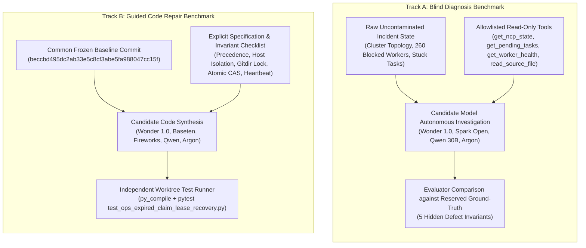

# InnerOS Autonomous Benchmark Methodology v2
## Rigorous Evaluation Protocol: Blind Diagnosis vs. Guided Repair
**Document ID:** `inneros-benchmark-methodology-v2-20261104`  
**Organization:** InnerChispa LLC | **Author:** Rafael López & Antigravity Autonomous Pair  
**Baseline Commit:** `beccbd495dc2ab33e5c8cf3abe5fa988047cc15f`  
**Test Suite:** `platform/tests/test_ops_expired_claim_lease_recovery.py`  

---

## 1. Motivation: Eliminating Benchmark Contamination

Earlier iterations of the benchmark included ground-truth defect descriptions directly inside the candidate system prompt or incident dossier. While this demonstrated code generation capability under explicit constraints, it did not isolate autonomous discovery from code synthesis.

Methodology v2 establishes a **strict bifurcation into two independent evaluation tracks**:

---

## 2. Track A: Blind Diagnosis Protocol

### Inputs Provided to Candidates:
- Frozen infrastructure snapshot (`inneros_global_snapshot.json`, SHA-256 `92796a036c6fd89643a0be11898723d60b679565a86edcd88cb11583db5d5f83`).
- Observed symptoms: 0 active workers, 260 blocked workers, tasks stuck in `awaiting_antigravity_claim` and `claimed` with expired leases.
- Cluster topology: Primary AMD server (`ralfiia-amd`) online, Secondary Intel server (`ralphi-ia-ver-10`) offline.
- Allowlisted read tools only.
- **Strictly Omitted:** Root causes, proposed solutions, Argon reference patch, test assertions.

### Evaluation Criteria:
The evaluator inspects the candidate's diagnostic text and tool-calling trace against the **5 Reserved Ground-Truth Defects**:
1. **D1:** Interactive lane precedence (`awaiting_antigravity_claim`).
2. **D2:** Remote host PID safety hazard (`ralphi-ia-ver-10`).
3. **D3:** Linked worktree git pointer detection (`gitdir: ...` -> `index.lock`).
4. **D4:** Atomic CAS with revision and lease filter (`modified_count == 1`).
5. **D5:** Worker liveness pre-condition check (< 180s heartbeat / active PID).

---

## 3. Track B: Guided Repair Protocol

### Inputs Provided to Candidates:
- Frozen baseline commit: `beccbd495dc2ab33e5c8cf3abe5fa988047cc15f`.
- Function contract: `recover_orphan_interactive_ops_tasks(limit: int = 10, *, remote_liveness_verifier = None) -> dict[str, Any]`.
- Explicit 5 invariant specifications from `expediente_guiado_reparacion.json`.

### Independent Execution Environment:
1. Fresh checkout of `beccbd495dc2` in an isolated git worktree.
2. Injection of the target test suite `platform/tests/test_ops_expired_claim_lease_recovery.py` from reference commit `94d90d34`.
3. Application of candidate's generated patch.
4. Static syntax validation via `py_compile`.
5. Pytest execution capturing exact stdout, stderr, exit code, and execution time.
6. Static AST check for safety violations (detecting database mutations preceding preconditions).
7. Clean worktree destruction on completion.

---

## 4. Cost Accounting & Attribution Standards

To prevent misleading comparisons, all financial metrics follow strict classifications:

| Cost Classification | Definition | Applicable Models |
|---|---|---|
| **ACTUALLY_BILLED** | Actual dollar transaction verified against credit card / invoice ledger | Argon Reference ($0.00 in IDE) |
| **CREDIT_DEDUCTED** | Live provider balance deduction logged by API gateway | Baseten ($0.0023), Fireworks ($0.0014) |
| **PROVIDER_REPORTED** | Usage metrics calculated using official published price per million tokens | Meta Muse Wonder 1.0 ($0.0055), Modal ($0.000045) |
| **MARGINAL_API_ZERO** | Zero external API expense; sovereign local execution | Local Qwen3-Coder-30B-AWQ ($0.00) |

### Sovereign Hardware Amortization Note:
While Qwen3-Coder-30B incurs **$0.00 in marginal API fees**, enterprise total cost of ownership (TCO) includes physical hardware:
- AMD Radeon AI PRO R9700 (32GB VRAM): ~240W compute consumption under full load.
- Electricity cost in Ecuador (~$0.092/kWh): ~$0.00007 per 12.5s inference run.
- Zero per-token rate, unlimited privacy, immunity to provider rate limits or internet partition.
